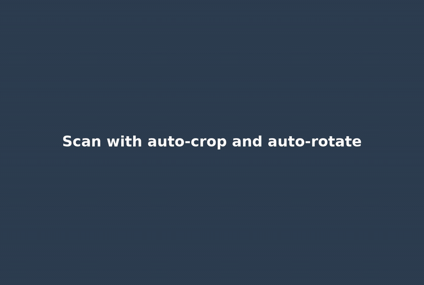

# Doxie Scanner

A standalone, self-hosted web app for a **Doxie Pro DX400** document
scanner. It talks to the scanner directly over USB, so there is no SANE,
no `scanimage` and no vendor software to install. Scan from your browser,
let the app trim and straighten photos and cards and turn pages upright,
review and fix pages, then download PDFs or send them to
[Paperless-ngx](https://docs.paperless-ngx.com/).

Ships as a single Docker image with the frontend baked into the binary.

**Specifically the Doxie Pro DX400, and Linux is the supported platform**
— this isn't a general Avision/Doxie driver. It talks to one exact device
(USB VID:PID `2740:000c`) and will not recognize any other scanner,
including other Doxie models. The Docker image is Linux (amd64) and reaches
the scanner through the USB device nodes under `/dev/bus/usb`.

> Not affiliated with, endorsed by, or sponsored by Doxie, Apparent Corp.,
> or Avision. "Doxie" and "Doxie Pro" are trademarks of their respective
> owners, referenced here only to describe hardware compatibility.



## How this was built

The scanner driver speaks **the protocol Doxie's own driver uses**: a
12-byte command set (an Avision-family SCSI dialect carried over USB) in
which the scanner JPEG-encodes each side itself. The byte sequences and
payloads were captured from Doxie's own Windows and macOS drivers talking
to real hardware, and implemented from scratch against that observed wire
data in the fork
[jasonlearst/doxie-scanner](https://github.com/jasonlearst/doxie-scanner)
(MIT). This project adopted that driver in place of its own first one: see
[Credits](#credits) for exactly what came from where. No vendor or SANE
source code is copied anywhere in this repository; reimplementing a
protocol from observed traffic is the same well-established basis projects
like Samba and Wine rely on.

The project's first driver (1.x) used the generic SCSI-2 scanner command
set instead and read raw pixels. It was replaced because the vendor
protocol is the one Doxie's software exercises: it is faster (the scanner
compresses on the device) and it keeps one scan job open across a stack, so
sheets feed back to back. The old driver is in the git history.

## Features

- Start single or multi-page (ADF) scans, simplex or duplex (duplex is the
  default), from the browser. The scanner JPEG-encodes each side on the
  device, and one scan job stays open for a whole stack so sheets feed
  without a pause between them
- "Start scan" is only enabled once the scanner is actually reachable — a
  live "connected / not connected" status badge backs it, no page refresh needed
- **Duplex scans number each side as its own independent page.** One
  duplex sheet followed by one simplex sheet produces 3 pages: 1 and 2
  are the duplex sheet's front and back, 3 is the simplex sheet — pages
  are numbered by image, not by physical sheet
- Automatic blank-back detection for duplex scans: a blank back simply
  doesn't become a page, rather than producing an empty one to delete later
- Click any page to open it in a full-size viewer with rotate (left/right
  90° — click repeatedly for 180°/270°), crop, export, delete, and OCR
  actions all in one place. Scanner problems come back in plain words:
  no paper in the feeder, a paper jam, the cover open, two sheets fed at
  once, or a sheet stopped partway through
- **Extract Text** runs OCR on a page and shows the result in a
  copy-pasteable box — automatically corrects a crooked scan first, since
  even a few degrees of skew measurably hurts recognition accuracy
- **Live progress**: while a scan runs, and after the scanner has stopped
  feeding, the new-scan card says what it is doing — checking for paper,
  scanning sheet 2, saving the pages, finishing up with the scanner,
  trimming pages to the sheet, turning pages upright (page 3 of 4, with a filling bar) — and keeps
  showing it until the pages have loaded, so the pause before the result
  never looks like a hang
- **Page switcher**: in the page viewer, the arrows in its header (or the
  left/right arrow keys) step to the previous or next page of the scan
  without closing it, with a "Page 2 of 4" counter
- **Auto-crop & straighten** (on by default): the scanner always reads
  its full 8.5 inch width, so a photo, card or receipt comes out as a
  small picture floating in gray backing. Auto-crop trims it to the sheet
  and straightens it if it fed in tilted (0.5° or more). It acts only
  when at least 20% of the scan is backing, so an ordinary page that
  fills the scan is never touched; that rule came from running the
  detector on real scans, where it was sometimes confidently wrong on
  full pages. A page it changes keeps its as-scanned image, shown as
  "auto-cropped", and *Restore original* in the page viewer puts it back.
  Switch it off per scan (new-scan card; the choice is remembered) or run
  it on any finished scan from its header. The sheet finder is from the
  jasonlearst/doxie-scanner fork (`internal/pageimage`). When it finds only
  one edge of a sheet it trims that side and leaves the other's backing:
  incomplete, but it never cuts into the sheet
- **Auto-rotate** (on by default where tesseract's `osd` data is
  installed): turns each page upright from the text on it, so a sheet
  that fed in sideways or upside down comes out readable. Switch it off
  per scan (new-scan card) or run it on any finished scan from its
  header; a page with too little text to tell (a blank back, a photo) is
  left alone. Pages it turned are marked "auto-rotated" and can be
  turned back with the normal rotate buttons
- **Send to Paperless-ngx**: tick the pages you want, from one scan or
  several, and send them as one document with a title, date,
  correspondent, document type and tags chosen from your Paperless lists
  (anything left blank is up to Paperless's own rules). Each scan shows
  what was sent from it, follows the upload until Paperless has filed
  it, and links to the filed document
- Drag and drop to reorder pages within a scan
- Export a single page as PNG, JPEG, or PDF; export a whole scan as one
  combined PDF with one click; or hand-pick pages from **any number of
  past scans**, in any order, into one combined PDF **or a ZIP of separate
  PNG or JPEG images** (one selected page downloads as a plain image)
- Auto-named scans ("Scan 2026-07-14 15:30"), renamable afterward, with
  the scan list showing creation date/time and page count so similarly
  named scans stay easy to tell apart
- The UI is available in English and Spanish, auto-detected from the
  browser with a manual override (navbar dropdown, remembered for next
  time)
- No authentication, no database — just a REST API and a folder of files

## Requirements

- Docker (or a Go 1.27+ toolchain with a C compiler and libusb-1.0 dev
  headers, if running outside Docker)
- A Doxie Pro DX400 scanner connected over USB
- **A persistent volume mounted at `/data`.** This is not optional: scan
  data lives only in this directory, and if it's not backed by a real
  bind mount, every scan is lost the moment the container is recreated.
  The app refuses to start if `/data` isn't writable, but it cannot
  detect "writable anonymous volume" vs. "real persistent bind mount" —
  that part is on you. Always use `-v <host-path>:/data`.

## Quick start

```bash
docker run -d \
  --name doxie-scanner \
  -p 8080:8080 \
  -v ./data:/data \
  -v /dev/bus/usb:/dev/bus/usb \
  --device-cgroup-rule='c 189:* rmw' \
  ghcr.io/andiapps-dev/doxie-scanner:latest
```

Or with Compose:

```bash
docker compose up -d
```

Then open `http://localhost:8080`.

### USB passthrough

**Use the `-v /dev/bus/usb:/dev/bus/usb` + `--device-cgroup-rule='c 189:* rmw'`
combo shown above, not plain `--device=/dev/bus/usb`.** This matters more
than it looks: Docker's `--device` flag walks the directory *once, at
container start* and writes a device-cgroup ACL rule for each specific
bus/device number it finds at that moment. Unplugging and replugging the
scanner gets it a *new* bus/device number — the container can still see
that file (the bind mount is live), but the ACL computed at startup never
covered it, so opening it fails with something like
`libusb: no device [code -4]` even though `lsusb` shows the scanner fine.
`189` is the USB device major number and `*` matches any minor, so the
cgroup rule above covers whatever bus/device number the kernel assigns,
including ones that show up after the container is already running — no
restart needed after a reconnect.

Note this cgroup rule can't be scoped tighter than "all USB devices" (major
189) while still surviving reconnects — cgroup device rules match kernel
device numbers, not USB vendor/product IDs, and the whole reason for the
wildcard is that the number changes on every reconnect. There's no way to
name just this one scanner at that level.

The provided `udev/99-doxie-scanner.rules` (installed on the **host**, not
in the container) is solving a different, unrelated problem: the
container image runs as root by default specifically so it doesn't need
that rule (root can open any device node regardless of its file
permissions). If you harden the container to run as a non-root user
instead, standard Unix file permissions on the device node (typically
`root:root`, mode 0664) become the second gate a non-root process must
also clear — that's what the udev rule's `MODE="0666"` is for. It doesn't
replace or narrow the cgroup rule above; the two operate at different
layers (cgroup ACL: can this container touch USB devices at all; file
permissions: can this specific UID open this specific node).

Either way, confirm the scanner shows up before troubleshooting the app:

```bash
lsusb -d 2740:000c
```

## Using the web UI

Everything fits in one window, with no page scrolling: the header and the
new-scan card stay put, and the scan list and the open scan's pages each
scroll in their own area (the scan's header and the Select all row stay in
view while its pages scroll). The selection bar, when it shows, takes its
height from the bottom and the panels above shrink to fit. On a computer the
list sits beside the open scan; on a phone they take turns: tapping a scan
opens it with a **← Scans** button to go back. A window too short to fit it
all (under about 520 pixels tall) falls back to an ordinary scrolling page.

- **New scan**: the switches choose duplex, auto-crop and auto-rotate for
  the next scan, then *Start scan*. While it runs the card says what it is
  doing, and the running scan appears in the list. If the scanner can't be
  reached it says why and what to try (switch it on, plug it in; it can
  switch itself off after sitting idle).
- **Scans list**: every scan with its date, page count and state, newest
  first. *Select* turns the rows into checkboxes with *Select all* and a
  count; *Delete selected* asks first, saying how many scans and pages are
  about to go and, with Paperless set up, how many of those pages were
  never sent to it. A scan that is still running can't be ticked or
  deleted.
- **An open scan**: its name is edited where it is (a *Save* button
  appears while it has changed; Enter saves, Escape undoes). The buttons
  are the actions you use most: *Send to Paperless…* (the pages not in
  Paperless yet, or all of them if every page is), *Export PDF* (JPEG, or
  PNG from the arrow beside it), and *⋯* for the occasional ones:
  *Auto-crop pages*, *Auto-rotate pages* and *Delete scan*. Under it, what
  has been sent to Paperless and how it is going.
- **Pages**: one thumbnail per page, small JPEGs the server makes and
  keeps, so a long scan loads quickly even over a phone connection. Each
  carries its state ("auto-cropped", "auto-rotated", "in Paperless"). To
  reorder, drag a page with a mouse, or on a phone or tablet **press and
  hold, then drag** (a quick swipe still scrolls; the list scrolls by
  itself when you drag near its edge, and Escape cancels); the page viewer's
  *⋯* menu also has *Move earlier* and *Move later* for exact moves. Pages
  are labelled by their place in the scan, so the labels follow a reorder. Click or tap a page to open it. The tick-box in its corner selects it, and *Select
  all* / *Clear* above the grid do the whole scan.
- **Page viewer**: the arrows (or the left/right keys) step through the
  scan, and what has been done to the page is shown under its title.
  *Rotate*, *Crop* and *Extract text* are on the left; *Select page*,
  *Export* and *⋯* (*Restore original*, *Delete page*) on the right.
- **The selection bar**: ticked pages, from one scan or several, collect in
  a bar at the bottom with a thumbnail of each. Drag them (press and hold on a
  touch screen) to set the order, or × to drop one. *Send to Paperless…* sends them as one document with a
  title, date, correspondent, document type and tags, picked from your
  Paperless lists (tags are toggle buttons; anything left blank is up to
  Paperless's own rules). *Export PDF* downloads them as one PDF; its menu also offers a PDF with lossless PNG pages, or the pages as separate images in a ZIP (PNG, high-quality JPEG or smaller JPEG).
- **Undo**: deleting a page or a scan hides it at once and offers *Undo* for
  a few seconds before it is really deleted, so there is no confirmation to
  click through. Closing the page in that time leaves it undeleted.
- **Messages** (sent, trimmed, restored, deleted) appear as short toasts at
  the top, not pop-up boxes.

## Scripts

- `./build.sh [docker|local]` — build the Docker image (default) or a
  native binary at `./doxie-scanner`. Set `VERSION=v1.2.0` to bake a
  version into the build (see Releasing below); defaults to `dev`.
- `./test.sh` — `go vet` + `go build` + `go test` with the same coverage
  gate CI enforces (see Coverage below)
- `./run.sh` — run the locally-built image with the required data volume
  and USB passthrough already wired in

## API reference

All endpoints are JSON except where noted. No authentication.

| Method & path | Purpose |
|---|---|
| `GET /api/version` | `{"version": "..."}` — the git tag this build was released from, or `"dev"` for a local/untagged build. |
| `GET /api/scanner/status` | `{connected, vid, pid, driver, autoRotate, autoCrop, paperlessUrl?, error?}` — always 200; "not connected" is a normal poll result, not an HTTP error. `autoRotate` says whether auto-rotate is available (`autoCrop` is always true); `paperlessUrl` is set when sending to Paperless is configured. |
| `POST /api/scans` | `{"duplex": bool, "autoRotate": bool, "autoCrop": bool}` → starts a scan job. `autoCrop` (trim photos/cards to the sheet and straighten them) and `autoRotate` (turn each page upright; ignored when unavailable) are **off unless you send `true`**, so a script that sends only `{"duplex": true}` keeps getting pages exactly as scanned. The web app sends both as `true` unless you switch them off. `202 {jobId, status}`. `409` if a scan is already running. |
| `GET /api/scans` | List jobs, newest first. Each carries `unsentPages`: how many of its pages are in no Paperless document that went through. |
| `GET /api/scans/{id}` | Full job detail + pages; while running, also includes live `pagesScanned` progress and what the scan is doing: `stage` (`checking`, `scanning`, `saving`, `releasing`, `cropping` or `rotating`) with `stageDone` / `stageTotal` where it has a count (the sheet number while scanning, the page of the total while turning pages upright). |
| `PATCH /api/scans/{id}` | `{"name": "..."}` — rename a scan. |
| `DELETE /api/scans/{id}` | Delete a scan and all its pages. `409` while the scan is still running (as does any edit to a running scan: rename, reorder, delete or rotate/crop a page, restore, auto-crop, auto-rotate). |
| `POST /api/scans/bulk-delete` | `{"ids": ["...", ...]}` → `{deleted: [ids], skipped: [{id, reason}]}`. Always 200 once the request is valid: a scan that is already gone (`not_found`), still running (`scan_running`) or fails on disk (`internal_error`) is reported in `skipped` and doesn't stop the rest. A repeated id counts once. `400` for an empty list. |
| `GET /api/scans/{id}/pages/{n}` | Raw page PNG. |
| `GET /api/scans/{id}/pages/{n}/thumb` | A small JPEG of the page (fitted into 360x480), made on first request and cached on disk. The cache is keyed by the page file's size and modified time, so an edited page never shows an old thumbnail. |
| `DELETE /api/scans/{id}/pages/{n}` | Delete one page. |
| `PATCH /api/scans/{id}/pages/order` | `{"order": [3,1,2]}` — reorders a scan's pages (a permutation of its existing page numbers). Page numbers, URLs, and filenames don't change — only their position. |
| `POST /api/scans/{id}/pages/{n}/rotate` | `{"degrees": 90\|180\|270}` — clockwise, in place. |
| `POST /api/scans/{id}/pages/{n}/crop` | `{"x","y","width","height"}` — in place. |
| `GET /api/scans/{id}/pages/{n}/export?format=png\|jpg\|pdf` | Single-page export, downloaded as an attachment. |
| `GET /api/scans/{id}/pages/{n}/ocr` | `{"text": "..."}` — runs OCR (with automatic deskew) and returns the recognized text. Not cached; regenerated on every call. |
| `POST /api/scans/{id}/auto-crop` | Trims every page of a finished scan that has at least 20% backing to its sheet, straightening it if tilted by 0.5° or more. A changed page gets `autoCrop` (what was done) and `original` (the kept as-scanned file) in its metadata. Returns the updated scan. `409` while the scan runs. |
| `POST /api/scans/{id}/pages/{n}/restore` | Puts a page back exactly as scanned (undoing an automatic crop and anything done to the page since) and removes the kept copy. `404` if the page has no original, i.e. it was never changed automatically. |
| `POST /api/scans/{id}/auto-rotate` | Turns every page of a finished scan upright from its text; pages with too little text are left alone. Returns the updated scan (each turned page has `autoRotated` set to the clockwise degrees applied). `503` when tesseract's `osd` data isn't installed, `409` while the scan runs. |
| `GET /api/paperless/metadata` | `{tags, correspondents, documentTypes}` from Paperless, each `[{id, name}]`. `503` if Paperless isn't configured, `502` if it can't be reached or rejects the token. |
| `POST /api/paperless/send` | `{"pages":[{"jobId","page"}...], "title", "created":"YYYY-MM-DD", "correspondent":id, "documentType":id, "tags":[id...]}` — builds one PDF from the pages in the order given and uploads it. Zero IDs and an empty date are left to Paperless. `202 {title, taskId}`; each scan the pages came from records the document under `sent`. |
| `POST /api/scans/{id}/sent/refresh` | Asks Paperless how each of the scan's queued or processing uploads is doing, saves the answer and returns the updated scan. |
| `POST /api/export/combine` | `{"pages":[{"jobId","page"}...], "title"}` — combines pages **from any scans** into one PDF, in the given order. |
| `POST /api/export/images` | `{"pages":[{"jobId","page"}...], "title", "format":"png"\|"jpeg", "quality"}` — streams the pages, in the given order, as a ZIP of separate images (`<title>-001.png`…). PNG is stored unchanged; JPEG quality is 1–100 (default 90). |

Errors look like:

```json
{"error": {"code": "device_not_found", "message": "no USB device with VID 0x2740 PID 0x000c found — is it powered on and connected?"}}
```

| Code | Meaning |
|---|---|
| `device_not_found` | No matching USB device. Check power and cabling; confirm with `lsusb -d 2740:000c`. |
| `claim_interface_failed` | Device found, but its USB interface couldn't be claimed — usually a permissions issue (see USB passthrough above) or another process already has it open. |
| `scsi_error` | A command to the scanner failed. When the scanner itself reports a problem, such as a paper jam, the message says so in plain words and a scan fails with it. |
| `not_found` | The requested job or page doesn't exist. |
| `bad_request` | Malformed input (bad JSON, invalid page number, unsupported export format, etc). |

## Extending to other scanners

This app is built around a small `driver.Driver`/`driver.Session`
interface (`internal/driver`); nothing in job orchestration, storage, the
HTTP API, or the frontend knows about the Doxie DX400 specifically. A
second scanner would add a package that implements that interface and
registers itself under a name (see `internal/doxiedx400`, the one
implementation today, for the shape), reusing `internal/scsiusb` (the USB
transport and the 12-byte command framing) if it speaks the same
Avision-family dialect. Select the driver with the `DOXIE_DRIVER`
environment variable (default `doxie-dx400`).

## Configuration

| Env var | Default | Purpose |
|---|---|---|
| `DOXIE_DATA_DIR` | `/data` | Where scan jobs are stored. Must be writable; see above. |
| `DOXIE_LISTEN_ADDR` | `:8080` | HTTP listen address. |
| `DOXIE_DRIVER` | `doxie-dx400` | Which registered driver to use. Only `doxie-dx400` exists today. |
| `DOXIE_PAPERLESS_URL` | *(unset)* | Address of your Paperless-ngx, as this server reaches it, e.g. `http://paperless.lan:8000`. With the token, turns on *Send to Paperless*. |
| `DOXIE_PAPERLESS_TOKEN` | *(unset)* | A Paperless API token (Paperless → your name → My Profile → API Auth Token). Both this and the URL must be set. Keep it out of the compose file: put both in a `.env` next to it (see `.env.example`). |
| `DOXIE_OCR_LANG` | `eng` | Tesseract language code "Extract Text" uses. Anything besides `eng` needs the matching `tesseract-ocr-data-<lang>` package added to a custom build — only English data ships in the published image. |

## Local development

Requires cgo and libusb-1.0 dev headers (`libusb-1.0-0-dev` on
Debian/Ubuntu, `libusb-dev` on Alpine):

```bash
go build ./...
go vet ./...
go test ./...
```

### Coverage

This project targets **≥95% Go test coverage**, achieved by isolating the
one genuinely hardware-dependent file
(`internal/scsiusb/usbdevice.go` — a thin adapter over real USB calls
that can't be meaningfully exercised without the physical scanner) behind
an interface, with everything else — protocol/CDB construction, the
retry/sense state machine, image processing, job orchestration, PDF
export, and the full HTTP API — tested against in-memory fakes.

```bash
go test -coverprofile=coverage.out ./...
grep -v internal/scsiusb/usbdevice.go coverage.out > coverage.filtered.out
go tool cover -func=coverage.filtered.out | tail -1
go tool cover -html=coverage.filtered.out -o coverage.html
```

The frontend (`internal/web/static/app.js`) is plain vanilla JS and is
not part of this coverage figure.

## Releasing

Versions are git tags on this repo, following [Semantic
Versioning](https://semver.org/): `vMAJOR.MINOR.PATCH` (e.g. `v1.2.0`).
Bump PATCH for fixes, MINOR for backward-compatible features, MAJOR for
a breaking change to the HTTP API or the on-disk `meta.json` schema.

Pushing a `vX.Y.Z` tag does the rest automatically:
`.github/workflows/docker-publish.yml` re-runs the full CI test/coverage
gate, then — only if that passes — builds the image with `main.version`
set to the tag (surfaced at `GET /api/version`), pushes
`ghcr.io/andiapps-dev/doxie-scanner` tagged `X.Y.Z`, `X.Y`, and `latest`,
and creates a GitHub Release for the tag with auto-generated notes. A
plain push to `main` with no tag only runs CI — it never publishes an
image, so `:latest` always means "latest release," not "whatever's
currently on main."

## Using the scanner

- **"Scanner not connected"** in the top bar: check the scanner is
  switched on and plugged in. It can switch itself off after sitting
  idle; press its power button and the badge turns green by itself. Then
  confirm it's visible to the host with `lsusb -d 2740:000c` (see USB
  passthrough above).
- **A paper jam** is reported as one: open the scanner, take the sheet
  out, then switch the scanner off and on before scanning again.
- The scanner takes paper from the top tray (stacks), the slot at the back
  (single sheets) and the tray at the front. The scanner always reads its
  full 8.5 inch width, which is why a photo or card comes out surrounded
  by gray backing and why auto-crop exists.

## Credits

- **[jasonlearst/doxie-scanner](https://github.com/jasonlearst/doxie-scanner)**
  (MIT, a fork of this project made at 1.0.8). This project's scanner
  driver, and several features, are adapted from that work, with thanks:
  - the **driver for the Doxie's own protocol** (`internal/doxiedx400`):
    the 12-byte commands, the SET WINDOW payloads, the on-device JPEG mode,
    and the sequence that keeps one scan job open across a stack, all taken
    from USB captures of Doxie's own drivers, together with the real
    captured scan data its tests use; and the matching USB transport
    (`internal/scsiusb`: the command framing and the control-transfer send)
  - the **Paperless-ngx client** (`internal/paperless`)
  - the **sheet detector** that finds a photo or card in the scan and its
    tilt (`internal/pageimage`), which auto-crop builds on
  - the lessons that went with them: feed the next sheet while the last is
    being processed, and keep the scan job reserved for the whole stack
- Everything else (the web app, storage, the API, PDF and OCR export,
  auto-rotate, auto-crop's safety rule, bulk delete, progress, and the
  original 1.x driver in the git history) is this project's own.

## License## License

MIT — see [LICENSE](LICENSE).

Portions are adapted from [jasonlearst/doxie-scanner](https://github.com/jasonlearst/doxie-scanner)
(MIT); see Credits above.

This project uses [`google/gousb`](https://github.com/google/gousb)
(Apache-2.0) for USB access, [`disintegration/imaging`](https://github.com/disintegration/imaging)
(MIT) for rotate/crop/straighten, and [`go-pdf/fpdf`](https://github.com/go-pdf/fpdf)
(MIT) for PDF generation. The Docker image also runs
[Tesseract](https://github.com/tesseract-ocr/tesseract) (Apache-2.0) for
OCR and for reading a page's orientation, and
[unpaper](https://github.com/unpaper/unpaper) (GPL-2.0-or-later) to
straighten a page before OCR, each as a separate program. The frontend vendors
[Bootstrap](https://getbootstrap.com/) / [Bootswatch "Flatly"](https://bootswatch.com/flatly/)
(MIT) and [Cropper.js](https://fengyuanchen.github.io/cropperjs/) (MIT).
